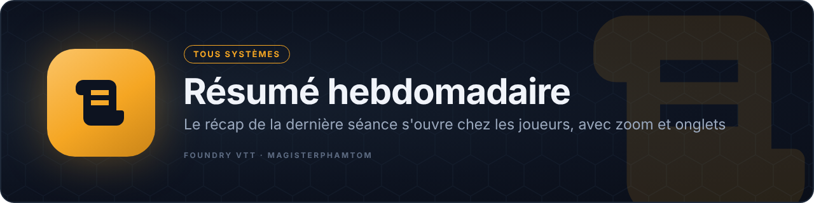

# Résumé hebdomadaire

Module Foundry VTT (v13/v14) qui affiche aux joueurs l'image du résumé de la dernière séance.

## Fonctionnalités

- **Ouverture automatique à la connexion** : le résumé s'affiche une fois par joueur et par nouveau résumé.
- **Bouton 📜 « Résumé de la semaine »** dans la barre d'outils de gauche : rouvre la fenêtre si elle a été fermée par inadvertance.
- **Zoom à la molette** (centré sur le curseur), **déplacement en glissant**, **double-clic** pour ajuster à la fenêtre ; boutons + / − / ajuster. L'image tient toujours dans la fenêtre au départ, quelle que soit la taille d'écran, et la fenêtre est redimensionnable.
- **Onglets par séance** (si `index.json` est présent) pour relire les résumés précédents.
- **Bouton MJ « Montrer à tous »** : affiche le résumé immédiatement chez les joueurs déjà connectés.

## Installation

Dans Foundry : Modules complémentaires, Installer un module, puis coller le lien du manifeste :

`https://github.com/magisterphamtom/resume-hebdo/releases/latest/download/module.json`

## Utilisation chaque semaine

Les résumés se trouvent dans `worlds/<monde>/resume/` (dossier de données de Foundry).

**Avec onglets (recommandé)** : un fichier `index.json` liste les séances, et le module affiche un onglet par séance à gauche de l'image (la plus récente en premier, avec un repère « Nouveau »).

```json
{
  "resumes": [
    { "session": 106, "titre": "Titre court", "fichier": "session-106.webp" },
    { "session": 105, "titre": "Une lame sous la gorge", "fichier": "session-105.webp" }
  ]
}
```

Chaque semaine : déposez la nouvelle image dans le dossier et ajoutez une ligne à `index.json`. Les joueurs ne peuvent pas parcourir les fichiers, c'est pourquoi la liste est nécessaire.

**Sans onglets** : sans `index.json`, le module affiche simplement `dernier-resume.webp` (ou `.png`, `.jpg`) et détecte tout seul quand il est remplacé.

Dans les deux cas, le résumé le plus récent s'ouvre automatiquement à la connexion des joueurs. Pour ceux déjà connectés, cliquez sur **Montrer à tous** dans la fenêtre.

## Réglages

- **Image du résumé (facultatif)** (MJ) : à renseigner seulement pour utiliser un autre fichier que celui par défaut.
- **Ouvrir le résumé à la connexion** (chaque utilisateur) : activé par défaut.

## Licence

MIT
